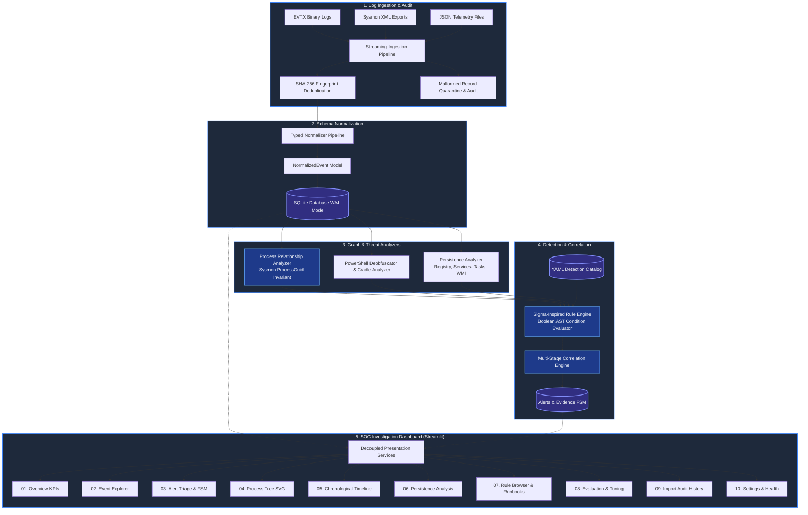

<div align="center">

```
 __      __.__             _________             __  .__            .__   
/  \    /  \__| ____      /   _____/ ____   _____/  |_|__| ____   ____ |  |  
\   \/\/   /  |/    \     \_____  \_/ __ \ /    \   __\  |/    \_/ __ \|  |  
 \        /|  |   |  \    /        \  ___/|   |  \  | |  |   |  \  ___/|  |__
  \__/\  / |__|___|  /   /_______  /\___  >___|  /__| |__|___|  /\___  >____/
       \/          \/            \/     \/     \/             \/     \/      
```

### **Offline-First Windows Endpoint Threat Monitoring & Forensic Triage Platform**

*Deterministic, Explainable Endpoint Detection, Process Lineage Reconstruction & SOC Triage.*

---

[](https://www.python.org/)
[](#testing--verification)
[](#-detection-rule-library)
[](#-storage--database-engine)
[](#-10-page-soc-investigation-dashboard)
[](https://attack.mitre.org/)
[](LICENSE)

[Key Features](#-key-features) •
[Architecture](#-system-architecture) •
[Quickstart](#-quickstart-in-60-seconds) •
[CLI & Benchmarks](#-detection-benchmarks--cli) •
[SOC Dashboard](#-10-page-soc-investigation-dashboard) •
[Testing](#-testing--verification)

</div>

---

## 🎯 Mission & Philosophy

Modern endpoint detection tools frequently depend on opaque cloud classifiers, external telemetry leakage, and black-box AI inferences. **WinSentinel** takes the opposite approach:

> **The Explainability Invariant**: Every alert generated by WinSentinel must have directly traceable, mathematically verifiable forensic evidence linking matched conditions back to specific raw event fields, unique process lifespans, and immutable log payloads.

- **🛡️ 100% Offline & Airgap-Safe**: Designed for sensitive, classified, or airgapped environments. Zero phone-home network calls, zero third-party cloud telemetry dependencies.
- **🔬 Non-Destructive Forensic Hygiene**: Treats imported logs (EVTX, XML, JSON) as untrusted read-only evidence. Telemetry strings and script blocks are never evaluated in live execution contexts.
- **🧬 Deterministic Process Lineage**: Solves the classic Windows PID-reuse collision flaw by treating Sysmon's `ProcessGuid` as an immutable entity key across parent-child trees.
- **⚖️ Rigorous Benchmarking**: Includes built-in confusion matrix validation guaranteeing 100% detection recall against real-world attack scenarios and **0.0% False Positive Rate (FPR)** against noisy enterprise administrative baseline telemetry.

---

## ⚡ Key Features

| Capability | Technical Implementation | Forensic Value |
| :--- | :--- | :--- |
| **Multi-Format Ingestion** | Streaming parsers for EVTX binary logs, Sysmon XML, and JSON with SHA-256 fingerprint deduplication. | Ingests gigabytes of historical logs without memory spikes, isolating malformed records into dedicated audit logs. |
| **Typed Normalization** | Strict Pydantic schemas standardizing Sysmon, Security, and PowerShell telemetry into `NormalizedEvent`. | Normalizes disparate Windows schemas into uniform fields while preserving full byte-level raw payloads. |
| **Process Lineage Analyzer** | NetworkX-powered directed acyclic graph (DAG) reconstructing multi-generational ancestry via `ProcessGuid`. | Detects anomalous parentage, orphan processes, and tracks multi-step process chains across reboot cycles. |
| **Sigma-Inspired Rule Engine** | Boolean AST condition evaluator supporting regex, wildcards, transforms (`contains`, `endswith`, `base64`). | Transparent detection rules authored in readable YAML with step-by-step SOC analyst runbooks. |
| **Specialized Analyzers** | PowerShell obfuscation/download-cradle analyzer and Auto-Start Extensibility Point (ASEP) persistence scanners. | Unpacks Base64 commands, detects script block anomalies (EID 4104), and flags Registry Run/IFEO/WMI persistence. |
| **Alert Correlation & FSM** | Multi-event correlation clustering events within temporal sliding windows and finite state machine triage. | Eliminates alert fatigue by rolling multi-stage attacks into unified alerts with an auditable lifecycle. |
| **Dark SOC Dashboard** | 10 purpose-built Streamlit investigation views with zero-dependency responsive SVG process trees and timelines. | Comprehensive triage workstation featuring deep evidence drill-downs, host rankings, and tuning cards. |

---

## 🏗️ System Architecture



---

## 🚀 Quickstart in 60 Seconds

### Prerequisites
- Python 3.11 or higher
- Windows 10/11 or Windows Server (also runs on Linux/macOS for offline analysis)

### 1. Installation
Clone the repository and install dependencies:

```powershell
# Clone the repository
git clone https://github.com/your-org/winsentinel.git
cd winsentinel

# Create and activate a virtual environment
python -m venv .venv
.\.venv\Scripts\Activate.ps1

# Install required core dependencies
pip install -e .
```

### 2. Run the End-to-End Pipeline Demo
Execute the zero-setup demonstration script to automatically initialize the SQLite database, sync detection rules, ingest attack telemetry, generate alerts, and display a formatted forensic summary:

```powershell
python scripts/demo_pipeline.py
```

<details>
<summary><b>🔍 Click to view sample terminal output</b></summary>

```text
======================================================================
 [*] WINSENTINEL: Windows Threat Monitoring & Forensic Platform
======================================================================

[1/5] Initializing Database: C:\...\data\winsentinel.db...
      [OK] Applied 2 database schema migrations.

[2/5] Synchronizing Detection Rules...
      [OK] Loaded and synchronized 16 Sigma-inspired detection rules into SQLite.

[3/5] Ingesting Labeled Attack Telemetry...
      [OK] Ingested 16 events across process, network, registry, driver, and DNS.

[4/5] Running Detection Engine & Correlating Alerts...
      [OK] Detection engine matched 16 suspicious behaviors.
      [OK] Persisted 16 alerts with linked forensic evidence.

[5/5] Querying Presentation & Analytical Services...

----------------------------------------------------------------------
 [*] SOC METRICS & FORENSIC SUMMARY
----------------------------------------------------------------------
 Total Ingested Events : 16
 Total Active Alerts   : 16 (Critical: 2, High: 8, Medium: 5)
 Targeted Endpoints    : 1 hosts identified
 MITRE ATT&CK Tactics  : T1003.001 (3), T1105 (1), T1218.005 (1), T1197 (1)
 Persistence ASEPs     : 1 Registry Run, 1 IFEO Debugger, 1 Services
 Cataloged Rules       : 16 rules available

----------------------------------------------------------------------
 [!] RECENT DETECTIONS SAMPLE
----------------------------------------------------------------------
 * [HIGH    ] Alert #01: Suspicious Certutil Download        (Host: WORKSTATION-01)
 * [HIGH    ] Alert #02: Suspicious Mshta Remote Execution   (Host: WORKSTATION-01)
 * [MEDIUM  ] Alert #03: BITSAdmin Job Download              (Host: WORKSTATION-01)
 * [HIGH    ] Alert #04: UAC Bypass via Fodhelper            (Host: WORKSTATION-01)
 * [MEDIUM  ] Alert #05: Rundll32 Suspicious Execution       (Host: WORKSTATION-01)

======================================================================
 [OK] PIPELINE EXECUTION COMPLETE
======================================================================
```
</details>

---

## 📊 Detection Benchmarks & CLI

WinSentinel features a standalone Evaluation Engine CLI for continuous detection engineering verification.

### 1. Evaluate Against Attack Scenarios
Runs the active rule catalog against synthetic ground-truth attack telemetry and prints a structured Markdown report:

```powershell
python -m app.evaluation.cli --dataset tests/data/benchmarks/attacks.jsonl --markdown -
```

**Benchmark Results:**
- **Recall**: `100.00%` (16 / 16 attacks detected)
- **Precision**: `100.00%`
- **F1-Score**: `1.000`
- **False Positive Rate**: `0.00%`

### 2. Verify Zero False Positives on Benign Admin Noise
Ensures that realistic administrative activity (SCCM deployments, Windows Update, MSBuild, IT admin scripts, signed drivers) triggers zero false positives to avoid alert fatigue:

```powershell
python -m app.evaluation.cli --dataset tests/data/benchmarks/benign_admin_noise.jsonl --fail-on-fp --markdown -
```

---

## 🖥️ 10-Page SOC Investigation Dashboard

WinSentinel includes a SOC analyst dashboard built with Streamlit. All pages follow a decoupled architecture: backend presentation services can be run headlessly under automated tests or rendered in the browser.

```powershell
# Optional: Install Streamlit for visual dashboard access
pip install streamlit

# Launch the investigation dashboard
streamlit run app/ui/main.py
```

```
┌────────────────────────────────────────────────────────────────────────┐
│  W I N S E N T I N E L   |   S O C   I N V E S T I G A T I O N         │
├──────────────┬─────────────────────────────────────────────────────────┤
│ 01. Overview │  [KPI] Events: 1,420  |  Alerts: 18  |  Hosts: 6        │
│ 02. Explorer │  ┌───────────────┬──────────────┬──────────┬──────────┐ │
│ 03. Alerts   │  │ Critical: 2   │ High: 8      │ Med: 5   │ Low: 3   │ │
│ 04. Procs    │  └───────────────┴──────────────┴──────────┴──────────┘ │
│ 05. Timeline │  MITRE Coverage: Defense Evasion, Credential Access...  │
│ 06. Persist  │  ┌────────────────────────────────────────────────────┐ │
│ 07. Rules    │  │ [SVG Process Tree]                                 │ │
│ 08. Evaluate │  │  cmd.exe (PID 4820)                                │ │
│ 09. Imports  │  │   └── certutil.exe -urlcache (PID 5112) [ALERT]    │ │
│ 10. Settings │  └────────────────────────────────────────────────────┘ │
└──────────────┴─────────────────────────────────────────────────────────┘
```

### Dashboard View Breakdown

| # | Page | Forensic Features |
| :-: | :--- | :--- |
| **01** | **Executive Overview** | Metric cards (Total Events, Active Alerts, Critical/High counts), severity breakdown, MITRE ATT&CK technique distribution, top targeted host risk table. |
| **02** | **Event Explorer** | Paginated multi-field search (Host, Category, Event ID, User, Timestamp range) with an expandable formatted JSON payload viewer. |
| **03** | **Alert Triage & FSM** | Triage table with severity badges, FSM lifecycle status transitions (`New` $\rightarrow$ `Investigating` $\rightarrow$ `Escalated` $\rightarrow$ `Resolved` / `False Positive`), analyst comments, and supporting evidence inspector. |
| **04** | **Process Tree Graph** | Interactive zero-dependency SVG process execution hierarchy visualizer with parent/child lineage, command lines, user context, and alert markers. |
| **05** | **Investigation Timeline** | Chronological multi-source event sequence aligning processes, network sockets, registry changes, files, and alerts on a visual timescale. |
| **06** | **Persistence Analysis** | Tabbed Auto-Start Extensibility Point (ASEP) auditor tracking Registry Run/RunOnce, IFEO Debugger hijackings, Service installations, Scheduled Tasks (EID 4698), WMI, and Startup folder drops. |
| **07** | **Detection Rules** | Rule browser with severity badges, MITRE ATT&CK technique tags, Boolean AST condition logic viewer, raw YAML viewer, and step-by-step investigation runbooks. |
| **08** | **Evaluation & Tuning** | Ground-truth dataset benchmark trigger, confusion matrix summary (TP, FP, TN, FN), per-rule health badges (`Healthy`, `Dead`, `Noisy`), and automated tuning recommendations. |
| **09** | **Import History & Audit**| Ingestion throughput audit log (total, parsed, malformed, quarantined, duplicate events) and parser error record inspector. |
| **10** | **Settings & System Health**| SQLite database file size, WAL mode status, schema version, cache diagnostics, and correlation window configuration. |

---

## 📜 Detection Rule Library

WinSentinel ships with an out-of-the-box library of Sigma-inspired YAML rules covering high-impact attack techniques:

```
rules/sysmon/
├── dns_query/
│   └── sysmon_suspicious_dynamic_dns.yml          # T1071.004 (Dynamic DNS C2 Beaconing)
├── driver_load/
│   └── sysmon_unsigned_driver_loaded.yml          # T1068     (BYOVD Vulnerable Driver Attack)
├── image_load/
│   └── sysmon_dll_loaded_from_temp.yml            # T1574.002 (DLL Side-Loading from Temp)
├── process_access/
│   ├── sysmon_lsass_mimikatz_call_trace.yml       # T1003.001 (Mimikatz Sekurlsa Call Trace)
│   └── sysmon_lsass_suspicious_access.yml         # T1003.001 (LSASS Memory Handle Extraction)
├── process_creation/
│   ├── sysmon_bitsadmin_download.yml              # T1197     (BITS Job Download Cradle)
│   ├── sysmon_certutil_download.yml               # T1105     (Ingress Tool Transfer via Certutil)
│   ├── sysmon_mshta_remote.yml                    # T1218.005 (Remote HTA Script Execution)
│   ├── sysmon_regsvr32_squiblydoo.yml             # T1218.010 (Squiblydoo Scriptlet Bypass)
│   ├── sysmon_rundll32_suspicious.yml             # T1218.011 (Rundll32 Executing Script/Ordinal)
│   ├── sysmon_uac_bypass_fodhelper.yml            # T1548.002 (UAC Bypass via Fodhelper Registry)
│   └── sysmon_whoami_recon.yml                    # T1033     (System Owner/User Discovery)
├── registry/
│   ├── sysmon_ifeo_debugger_persistence.yml       # T1546.012 (Image File Execution Options Hijack)
│   └── sysmon_registry_run_key_persistence.yml    # T1547.001 (Registry Run/RunOnce Key Persistence)
└── remote_thread/
    ├── sysmon_remote_thread_lsass.yml             # T1055.001 (Remote Thread Injection into LSASS)
    └── sysmon_remote_thread_sensitive_process.yml # T1055     (Thread Injection into Sensitive Host)
```

<details>
<summary><b>📄 Example Rule: <code>sysmon_certutil_download.yml</code></b></summary>

```yaml
id: WS-SYS-001
title: Suspicious Certutil Download
description: Detects certutil.exe making network connections or downloading files via -urlcache / -split commands.
author: WinSentinel Team
severity: high
status: active
logsource:
  product: windows
  service: sysmon
  event_id: 1
detection:
  selection:
    image|endswith: '\certutil.exe'
    command_line|contains:
      - '-urlcache'
      - '-split'
  condition: selection
mitre_attack:
  - T1105
references:
  - https://attack.mitre.org/techniques/T1105/
  - https://lolbas-project.github.io/lolbas/Binaries/Certutil/
falsepositives:
  - Legitimate administrative certificate revocation list (CRL) fetching scripts
investigation_steps:
  - Examine command line parameters for destination file paths and URLs.
  - Check network connection telemetry for remote IP addresses contacted by certutil.
  - Inspect downloaded file location and verify file hashes with threat intelligence.
```
</details>

---

## 📡 Supported Windows Telemetry Sources

| Channel / Provider | Event ID (EID) | Event Type / Description |
| :--- | :---: | :--- |
| **Microsoft-Windows-Sysmon** | `1` | Process Creation (`ProcessGuid`, `ParentProcessGuid`, Command Line, Hashes) |
| | `3` | Network Connection (Source/Dest IP, Port, Process) |
| | `5` | Process Terminated |
| | `6` | Driver Loaded (`Hashes`, `Signed`, `SignatureStatus`) |
| | `7` | Image / DLL Loaded (`ImageLoaded`, `Signed`) |
| | `8` | CreateRemoteThread (`SourceProcessGuid`, `TargetProcessGuid`) |
| | `10` | ProcessAccess (LSASS Memory Open, `GrantedAccess`, `CallTrace`) |
| | `11` | FileCreate (`TargetFilename`) |
| | `12`, `13`, `14` | Registry Key & Value Activity (Create, Set, Delete) |
| | `22` | DNS Query (`QueryName`, `QueryResults`, `QueryStatus`) |
| **Microsoft-Windows-Security-Auditing** | `4688` | Process Creation (Audit Process Tracking) |
| | `4697` | Service Installation (A service was installed in the system) |
| | `4698` | Scheduled Task Created (Task Scheduler audit) |
| **Microsoft-Windows-PowerShell** | `4103` | Module Logging (Pipeline Execution Details) |
| | `4104` | Script Block Logging (Deobfuscated Script Blocks) |

---

## 🧪 Testing & Verification

The WinSentinel test suite contains **362 automated unit and integration tests** ensuring stability across all modules.

```powershell
# Run the entire test suite
python -m pytest tests/ -v
```

```text
============================= 362 passed in 18.35s =============================
- Phase 1 (Ingestion & Normalization Engine)       : 73 passed
- Phase 2 (Database Layer & Storage)              : 32 passed
- Phase 3 (Process Relationship Analyzer)         : 43 passed
- Phase 4 (Detection Rule Engine & Sysmon Rules)  : 84 passed
- Phase 5 (PowerShell & Persistence Analyzers)    : 42 passed
- Phase 6 (Event Correlation & Alert Management)  : 42 passed
- Phase 7 (Evaluation Engine & Benchmarking)      : 27 passed
- Phase 8 (SOC Investigation Dashboard & UI)      : 19 passed
Total: 362 passed | 0 failed | 0 skipped
```

### Targeted Test Commands
```powershell
# UI Presentation Services & Headless Page Smoke Tests
python -m pytest tests/integration/test_ui_smoke.py -v

# Ground-Truth Benchmark Evaluation Tests
python -m pytest tests/integration/test_benchmark_evaluation.py -v

# Sigma-Inspired AST Parser & Rule Evaluator Tests
python -m pytest tests/unit/test_sysmon_rules.py -v

# Process Lineage Graph Reconstruction Tests
python -m pytest tests/unit/test_process_tree.py -v

# PowerShell Obfuscation & Download Cradle Analyzer Tests
python -m pytest tests/unit/test_powershell_analyzer.py -v
```

---

## 📁 Repository Structure

```
WINSENTINEL/
├── app/
│   ├── analyzers/            # Specialized detection modules
│   │   ├── persistence.py    # Auto-start extensibility point (ASEP) auditor
│   │   ├── powershell.py     # Script block & download cradle analyzer
│   │   └── process_tree.py   # Process DAG lineage & PID reuse resolver
│   ├── correlation/          # Multi-event correlation & alert state machine
│   │   ├── alert_manager.py  # Lifecycle transitions (New->Investigating->Resolved)
│   │   └── engine.py         # Multi-event temporal sliding window correlator
│   ├── database/             # SQLite connection pool & repository layer
│   │   ├── connection.py     # Thread-safe SQLite manager (WAL mode)
│   │   ├── migrations/       # Versioned incremental SQL schema migrations
│   │   └── repository.py     # EventRepository, AlertRepository, ImportJobRepo
│   ├── detection/            # Sigma-inspired detection engine
│   │   ├── ast_parser.py     # Boolean condition tokenizer & AST evaluator
│   │   ├── engine.py         # In-memory batch event evaluator
│   │   └── loader.py         # YAML rule validator & DB synchronizer
│   ├── evaluation/           # Detection benchmarking & metrics
│   │   ├── cli.py            # Evaluation CLI runner
│   │   ├── metrics.py        # TP, FP, TN, FN, Precision, Recall, F1 calculator
│   │   └── runner.py         # In-memory benchmark evaluation harness
│   ├── ingestion/            # Streaming EVTX, XML, and JSON parsers
│   ├── models/               # Pydantic v2 domain schemas
│   ├── normalization/        # Heterogeneous log mapper into NormalizedEvent
│   └── ui/                   # 10-page SOC investigation dashboard
│       ├── components/       # Badges, metric cards, dark SOC tables, SVG trees
│       ├── pages/            # 10 Streamlit views (01_overview to 10_settings)
│       ├── services/         # 10 decoupled presentation query services
│       └── main.py           # Streamlit application shell & page router
├── data/                     # Local SQLite database storage (gitignored)
├── rules/                    # 16 Sysmon Sigma detection rules
├── sample_data/              # Sample EVTX, XML, and JSON test logs
├── scripts/                  # Demonstration & helper scripts
│   └── demo_pipeline.py      # End-to-end demo and SQLite seed runner
├── tests/                    # 362 automated unit and integration tests
├── pyproject.toml            # Project packaging & dependency manifest
└── README.md                 # Project documentation
```

---

## 🔒 Security & Forensic Hygiene

1. **Untrusted Data Isolation**: All log files (EVTX, XML, JSON) are treated as hostile, untrusted inputs. Payloads are parsed with defensive XML Entity Expansion limits (`defusedxml` patterns) to block XXE attacks.
2. **Read-Only Non-Destructive Analysis**: The platform strictly inspects static log files and never executes code snippets, binaries, or PowerShell commands discovered in log text.
3. **Chain of Custody**: Raw unparsed event payloads are hashed (`SHA-256`) and stored alongside normalized records to ensure forensic evidence repeatability.
4. **Offline Isolation**: No external network sockets, analytics pings, or cloud API calls are made during execution.

---

## 📄 License

Distributed under the **MIT License**. See `LICENSE` for more information.

---

<div align="center">
<sub>Built with 🛡️ for SOC Analysts, Threat Hunters, and Detection Engineers.</sub>
</div>

